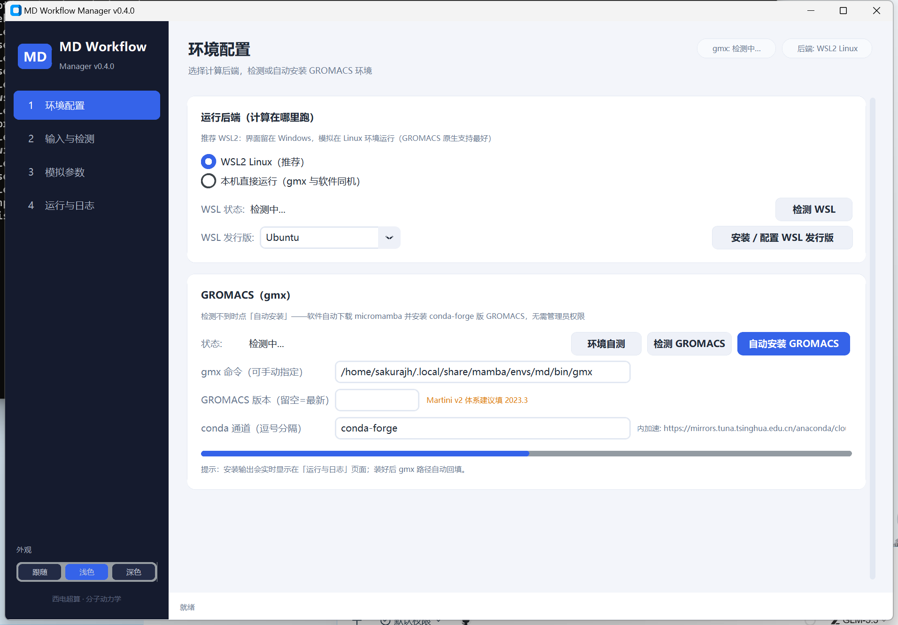

<div align="center">


# MD Workflow Manager

**分子动力学模拟流程管理软件 —— 接入 CHARMM-GUI 输出，一键完成 能量最小化 → NVT/NPT 平衡 → 生产模拟**

界面跑在 Windows，计算跑在 WSL2 Linux · 免安装 exe · 自动配置 GROMACS 环境

[](../../releases)
[](https://www.python.org/)
[](#-环境要求)
[](https://www.gromacs.org/)
[](LICENSE)
[](https://github.com/sakurajh/md-workflow-manager/actions/workflows/build.yml)

[功能特性](#-功能特性) · [快速开始](#-使用方法) · [工作原理](#-自动环境安装原理) · [打包](#-打包成可执行文件) · [常见问题](#-常见问题)



</div>

---

一个本地图形化软件：输入 **CHARMM-GUI（GROMACS 格式）输出目录**，在界面中配置模拟参数，
软件自动完成 **能量最小化 → 平衡（NVT/NPT）→ 生产模拟** 全流程，
实时显示当前步骤、进度与预计剩余时间，日志与结果输出到指定目录。

**界面运行在 Windows（打包为 .exe），模拟计算运行在 WSL2 Linux 环境**，
无需自己折腾 Linux 环境 —— 没有 GROMACS 时软件会自动安装。

## ✨ 功能特性

- 📦 **免安装 exe**：打包为单文件 `MDWorkflowManager.exe`（约 9 MB），双击即用，无需 Python
- 🐧 **模拟跑在 Linux**：Windows 界面 + WSL2 Linux 后端，计算环境就是 Linux（GROMACS 原生支持最好）
- ⚙️ **自动配置环境**：检测不到 GROMACS 时，软件自动下载 micromamba 并在 WSL 中安装
  conda-forge 版 GROMACS（无需管理员权限、无需手动敲命令）
- 📁 **一键接入 CHARMM-GUI**：选择 GROMACS 输出文件夹（或其父目录），自动识别
  力场、结构、各阶段 mdp 文件
- 🧬 **全原子 / 粗粒化自动区分**：按 topol.top 中的力场判定（CHARMM36 → 全原子，
  Martini → 粗粒化），可手动覆盖；粗粒化自动使用 20 fs 步长与 Martini 风格参数
- ⚙️ **界面化参数配置**：各阶段时长、温度、压力、位置限制、输出频率、恒温/恒压器、
  步长、并行线程数、GPU 加速等
- ▶️ **实时运行监控**：当前在跑哪个阶段、阶段内进度条、总体进度、预计剩余时间
- 📝 **完整日志**：界面内彩色实时日志 + 作业目录下的 `md_sim.log` 文件日志
- 🛑 **可取消、可续跑**：随时取消；某阶段失败后修复参数即可"从失败处继续"
- 🧪 **dry-run 模拟模式**：不调用 gmx 也能完整体验流程、验证参数（适合先熟悉软件）
- 🐧 **Linux 版可执行文件**：附打包脚本，可在 Linux 上生成原生可执行文件（本机运行模式）
- 📦 **压缩包直接导入**：CHARMM-GUI 下载的 tgz / tar.gz / zip 包可直接导入，自动解压并定位输出
- 💾 **参数保存/加载**：全部模拟参数可存为 JSON 文件，下次一键载入复用
- 🕘 **作业历史**：记录每次运行的输出目录与结果，可一键打开目录/查看汇总
- ✔️ **环境自测**：一键用最小水体系真实跑通 grompp + mdrun，验证后端环境可用
- 🎨 **现代界面**：CustomTkinter 侧栏导航 + 卡片式布局，浅色/深色双主题，自动适配高分屏 DPI（微软雅黑 UI）

## 环境要求

- **Windows 10 2004+ / Windows 11**（需要 WSL2 功能）
- 首次使用：软件内点"自动安装 GROMACS"，自动在 WSL Linux 中装好 GROMACS（约几分钟）
- 也可用已有的 GROMACS（WSL 内或本机 PATH 中）

## 使用方法

### 方式一：直接用打包好的 exe

```bat
MDWorkflowManager.exe
```

> exe 可从 [GitHub Releases](../../releases) 下载，或在本仓库的
> [Actions](../../actions) 页面由 CI 自动构建（推送到 main 即触发，双平台）。

### 方式二：源码运行

```bash
python main.py            # 启动图形界面
python main.py --selftest # 运行自检（无需 GROMACS）
python main.py --cli <输入目录或压缩包> -o 输出目录   # 控制台模式（服务器 / nohup / tmux）
python gui_test.py        # GUI 全功能自动化测试（38 项，Windows 桌面环境）
```

### 四个页签

1. **① 环境配置**：选择运行后端（推荐 WSL2 Linux），检测 WSL / GROMACS，
   缺失时点"⚙ 自动安装 GROMACS"（软件自动装好，含 micromamba 下载、conda 环境创建、gmx 验证）。
   国内网络慢可把 conda 通道换成清华镜像
   `https://mirrors.tuna.tsinghua.edu.cn/anaconda/cloud`。
2. **② 输入与检测**：选择 CHARMM-GUI 输出目录 → "开始检测"。
   确认力场 / 模拟类型（可手动改）/ 原子数 / 发现的阶段。
3. **③ 模拟参数**：设置输出目录（必填）、并行线程数、GPU 加速；
   选择阶段（EM / 各平衡阶段 / 生产模拟）逐项配置参数；"恢复默认"回到 CHARMM-GUI 原值。
4. **④ 运行与日志**：点击"▶ 启动"，实时查看阶段进度、总体进度、预计剩余时间与日志；
   完成后点"打开输出目录"查看结果。

## 自动环境安装原理

软件检测到 gmx 缺失时（一键触发，或点击"启动"时自动提示）：

```
下载 micromamba（静态单文件）→ 解压到 WSL ~/micromamba
→ micromamba create -n md -c conda-forge gromacs
→ 验证 gmx --version → 配置保存到 ~/.mdwf/config.json
```

全程无需管理员权限；安装输出实时显示在"④ 运行与日志"页签。

## 输出结构

作业目录（`输出目录/MD_sim_YYYYMMDD_HHMMSS/`）：

```
MD_sim_20260924_120000/
├── inputs/            # 复制的 CHARMM-GUI 输入（topol.top、力场、结构）
├── 01_step6.0/        # 每阶段输出（md.tpr / md.gro / md.cpt / md.edr / md.xtc / md.log）
├── 02_step6.1/        #   （目录名为"阶段序号_阶段key"，mdp 为覆盖后的最终参数）
├── ...
├── 07_step6.6/        # 生产模拟轨迹
├── md_sim.log         # 全程日志
└── run_summary.txt    # 运行参数与结果汇总
```

## 打包成可执行文件

```bat
:: Windows（得到 dist\MDWorkflowManager.exe）
build_windows.bat
```

### Linux / Rocky 9.2 版

软件完整支持在 Rocky Linux 9.2 上原生运行（本机后端，缺 GROMACS 可在软件内自动安装）。
**注意 glibc 兼容性：必须在 Rocky 9.2（或更老系统）上构建**，产物才能在 9.2 上运行。

方式一：在 Rocky 9.2 机器上直接构建（推荐）

```bash
chmod +x build_linux.sh && ./build_linux.sh
# 依赖缺失时脚本会用 dnf 自动安装（python3-tkinter 等）
# 产物: dist/MDWorkflowManager
```

方式二：用 Docker 可复现构建（任何有 Docker 的机器）

```bash
docker build -f Dockerfile.rocky92 -t mdwf-build .
docker run --rm -v "$PWD/dist-linux:/out" mdwf-build
# 产物: dist-linux/MDWorkflowManager
```

方式三：推送到 GitHub，[Actions](../../actions) 会自动在 rockylinux:9.2 容器内构建并上传产物。

运行要求：图形桌面环境（GNOME/X11 均可）；GUI 是中文界面，建议安装中文字体
（如 `dnf install google-noto-sans-cjk-ttc-fonts`）。

## 常见问题

| 问题 | 处理 |
|---|---|
| 点"自动安装 GROMACS"没反应/失败 | 查看"④ 运行与日志"页签输出；网络慢时换清华镜像通道 |
| 提示 WSL 不可用 | 点"安装/配置 WSL 发行版"（需管理员权限，可能需重启） |
| 想确认环境是否可用 | ① 环境配置页签点"环境自测"，真实跑通 grompp+mdrun 才算数 |
| GPU 加速勾不了 | 当前 gmx 是 CPU 版（软件自动检测并禁用 GPU 选项），换 GPU 版 gmx 即可 |
| 勾了 GPU 但 WSL 无可用 GPU 设备 | 软件自动回退 CPU 重跑本阶段并记录警告，运行不会中断 |
| 提示 Martini v2 不兼容 | 检测到旧版 Martini v2 力场且 GROMACS ≥ 2023.3 时会提示：点"是"自动安装兼容的 GROMACS 2023.3（独立 conda 环境），完成后自动切换 |
| 阶段失败 | 查看界面日志与 `md_sim.log`，修改参数后点"从失败处继续" |
| 想本机直接跑 | ① 环境配置页签切到"本机直接运行" |
| CHARMM-GUI 输出是 tgz/zip 压缩包 | ② 页签点"导入压缩包 (zip/tgz)..."直接导入，自动解压检测 |

## 项目结构

```
main.py                入口（--selftest / --cli / GUI）
mdflow/
├── config.py          常量、AA/CG 默认参数、gmx 命令构建、后端/环境常量
├── logger.py          文件 + 界面双写日志
├── backend.py         运行后端：本机 / WSL2 Linux（路径转换、命令包装）
├── envsetup.py        WSL 检测、micromamba + conda-forge 自动安装 GROMACS
├── detect.py          CHARMM-GUI 识别、力场解析、阶段发现
├── mdp.py             mdp 解析 / 参数覆盖 / 模板生成
├── gmx.py             grompp/mdrun 子进程、进度解析、ETA、取消、dry-run
├── workflow.py        阶段编排、作业目录、运行汇总
├── gui.py             CustomTkinter 侧栏式界面（环境/输入/参数/运行 四页面）
└── selftest.py        自检（合成数据 + 真实 WSL 探测，无需 gmx）
build_windows.bat      Windows 打包脚本
build_linux.sh         Linux 打包脚本
Dockerfile.rocky92     Rocky 9.2 可复现构建
.github/workflows/     GitHub Actions 自动打包两个平台
```

## 🔭 后续可扩展

- [ ] 轨迹分析页签（RMSD / RMSF / Rg / 氢键等，gmx 分析命令一键运行）
- [ ] 结合自由能（gmx_MMPBSA / BAR）
- [ ] NAMD / OpenMM / Amber 引擎（`Backend` 抽象可扩展）
- [ ] 超算集群提交（PBS / Slurm 脚本生成）

## 📄 License

本项目基于 [MIT License](LICENSE) 开源。
